<!--
  =============================================================================
  SUBHAMITA ADHIKARI — Beyond the Code
  Premium Cosmic GitHub Profile README
  =============================================================================

  IMPORTANT — set these before publishing:
  1. Replace every occurrence of Arjun07707 with your GitHub username.
  2. This repository MUST be named exactly your GitHub username
     (github.com/<Arjun07707>/<Arjun07707>) for the profile README to render.
  3. Replace YOUR_EMAIL and YOUR_PORTFOLIO with your verified contact details.
  4. Verify each project repository link; slugs below are best-guess placeholders.
  5. Run the Contribution Snake workflow at least once (see section 11).

  Identity preserved from the original profile:
  Name: Subhamita Adhikari
  Location: Kolkata, India
  Education: B.Tech CSE — Minor: Astronomy, Astrophysics & Astrobiology
  Leadership: Microsoft Student Society UEMK · ACM UEMK Student Chapter (Treasurer)
  Projects: Employee Management · AI Claims Ace · Malware Detection ML
            Data Science Portfolio · Astronomy Research
  =============================================================================
-->

<!-- ============================ 1. ANIMATED HERO ============================ -->

  

  

  
  
  
  

<!-- ============================ 3. ABOUT ME ============================ -->
## About Me

Computer Science and Engineering graduate with a minor in Astronomy, Astrophysics &
Astrobiology. I build intelligent systems with AI and Machine Learning, engineer
full-stack applications, design thoughtful user experiences, and lead student
technical communities — all while exploring the cosmos through computational
modelling and space data analysis.

<b>Kolkata, India</b> &nbsp;·&nbsp; B.Tech CSE &nbsp;·&nbsp; Astronomy, Astrophysics &amp; Astrobiology

<!-- ============================ 4. CURRENTLY EXPLORING ============================ -->
### Currently Exploring

  Deep Learning &nbsp;·&nbsp; Neural Networks &nbsp;·&nbsp; Modern Full-Stack Architecture
  &nbsp;·&nbsp; System Design &nbsp;·&nbsp; Computational Astrophysics
  &nbsp;·&nbsp; Space Data Analysis

<!-- ============================ 5. TECH STACK ============================ -->
## Tech Stack

<table>
  <tr>
    <td align="center"><b>Programming Languages</b> 
      
    </td>
    <td align="center"><b>Frontend</b> 
      
    </td>
  </tr>
  <tr>
    <td align="center"><b>Backend</b> 
      
    </td>
    <td align="center"><b>Data Science &amp; AI/ML</b> 
      
    </td>
  </tr>
  <tr>
    <td align="center"><b>Databases &amp; Cloud</b> 
      
    </td>
    <td align="center"><b>Design &amp; Creative Tools</b> 
      
    </td>
  </tr>
  <tr>
    <td align="center"><b>Developer Tools</b> 
      
    </td>
    <td align="center"></td>
  </tr>
</table>

Icons via <a href="https://skillicons.dev">skillicons.dev</a>. Only technologies I actively use are listed.

<!-- ============================ 6. GITHUB ANALYTICS ============================ -->
## GitHub Analytics

<table>
  <tr>
    <td align="center">
      
    </td>
    <td align="center">
      
    </td>
  </tr>
  <tr>
    <td align="center">
      
    </td>
    <td align="center">
      
    </td>
  </tr>
</table>

Live data from <b>github-readme-stats</b>, <b>github-readme-streak-stats</b> and <b>activity-graph</b>. External services may be unavailable intermittently.

<!-- ============================ 7. FEATURED PROJECTS ============================ -->
## Featured Projects

<table>
  <tr>
    <td align="center"><b>Employee Management</b></td>
    <td align="center">
      
    </td>
    <td align="center">
      <a href="https://github.com/Arjun07707/employee-management">Repo</a> ·
      <a href="https://Arjun07707.github.io/employee-management/">Live (verify)</a>
    </td>
  </tr>
  <tr>
    <td align="center"><b>AI Claims Ace</b></td>
    <td align="center">
      
    </td>
    <td align="center">
      <a href="https://github.com/Arjun07707/ai-claims-ace">Repo</a> ·
      <a href="https://Arjun07707.github.io/ai-claims-ace/">Live (verify)</a>
    </td>
  </tr>
  <tr>
    <td align="center"><b>Malware Detection ML</b></td>
    <td align="center">
      
    </td>
    <td align="center">
      <a href="https://github.com/Arjun07707/malware-detection-ml">Repo</a> ·
      <a href="https://Arjun07707.github.io/malware-detection-ml/">Live (verify)</a>
    </td>
  </tr>
  <tr>
    <td align="center"><b>Data Science Portfolio</b></td>
    <td align="center">
      
    </td>
    <td align="center">
      <a href="https://github.com/Arjun07707/data-science-portfolio">Repo</a> ·
      <a href="https://Arjun07707.github.io/data-science-portfolio/">Live (verify)</a>
    </td>
  </tr>
  <tr>
    <td align="center"><b>Astronomy Research</b></td>
    <td align="center">
      
    </td>
    <td align="center">
      <a href="https://github.com/Arjun07707/astronomy-research">Repo</a> ·
      <a href="https://Arjun07707.github.io/astronomy-research/">Live (verify)</a>
    </td>
  </tr>
</table>

Project slugs are best-guess placeholders — verify each repository URL. Live demo links use the GitHub Pages convention and must be confirmed.

<!-- ============================ 8. EXPERIENCE & LEADERSHIP ============================ -->
## Experience & Leadership

**Microsoft Student Society, UEMK** — Community builder and student leader.
Helped organize technical sessions and peer-learning initiatives for the student developer community.

**ACM UEMK Student Chapter** — Treasurer.
Managed chapter finances and supported planning and execution of student computing events.

**Diversion 2k25 & Diversion 2k26** — Student community and event involvement.
Contributed to the planning and execution of the annual technical-cultural fest.

Roles and organizations preserved from the original profile. Dates are shown only where verified.

<!-- ============================ 9. ACHIEVEMENTS & CERTIFICATIONS ============================ -->
## Achievements & Certifications

  

<table>
  <tr>
    <td align="center"><b>Certifications</b></td>
    <td align="center"><b>Open Source &amp; Technical Achievements</b></td>
  </tr>
  <tr>
    <td align="center">
      <i>No verified certifications added yet.</i> 
      This section is ready to be populated.
    </td>
    <td align="center">
      Public contributions reflected in the activity graph above. 
      Add milestone badges here as they are earned.
    </td>
  </tr>
</table>

Trophies via <b>github-profile-trophy</b>. No certificates or achievements are fabricated — add verified items as they become available.

<!-- ==================== 10. BEYOND THE TERMINAL — COSMIC CORNER ==================== -->
## Beyond the Terminal — Into the Cosmos

  

Astronomy and space science are core to how I think about technology.

  Astronomy &nbsp;·&nbsp; Astrophysics &nbsp;·&nbsp; Astrobiology &nbsp;·&nbsp;
  Computational Modelling &nbsp;·&nbsp; Space Data Analysis &nbsp;·&nbsp;
  NASA/ESA Open Datasets &nbsp;·&nbsp; Stellar Evolution &nbsp;·&nbsp;
  Habitable Zones &nbsp;·&nbsp; Biosignature Detection

> “Somewhere, something incredible is waiting to be known.”
> 
— Carl Sagan (quotation preserved from the original README)

<!-- ============================ 11. CONTRIBUTION SNAKE ============================ -->
## Contribution Snake

  <picture>
    <source media="(prefers-color-scheme: dark)" srcset="https://github.com/Arjun07707/Arjun07707/raw/snake-output/github-snake-dark.svg">
    
  </picture>

Generated by <b>Platane/snk</b> via GitHub Actions. Light and dark variants are published to the <code>snake-output</code> branch.

  
Enable the contribution snake

  <ol>
    <li>Push <code>.github/workflows/snake.yml</code> to the default branch.</li>
    <li>Grant Actions write permission:
      <b>Settings → Actions → General → Workflow permissions → “Read and write permissions”</b>.</li>
    <li>Run the workflow once:
      <b>Actions → Contribution Snake → Run workflow</b>
      (it also runs daily on a schedule and on every push).</li>
    <li>Confirm the <code>snake-output</code> branch contains
      <code>github-snake-dark.svg</code> and <code>github-snake-light.svg</code>.</li>
  </ol>
  
No deploy keys or extra secrets are required — the workflow uses the default <code>GITHUB_TOKEN</code>.

<!-- ============================ 12. CONTACT ============================ -->
## Contact

  
  
  
  

  Open to collaborating on intelligent systems, thoughtful design, and anything that brings code a little closer to the cosmos.

  <b>Subhamita Adhikari</b> — Kolkata, India · B.Tech CSE · Astronomy, Astrophysics &amp; Astrobiology 
  <i>Where Code Meets the Cosmos.</i> 
  Built with SVG, Markdown, and GitHub Actions · No JavaScript, no fabricated data.

