  

  

  I'm a Computer Science undergraduate in Kolkata working across AI/ML, full-stack engineering, and interface design. 
  I care about turning ambiguous ideas into clear, useful systems — and about looking up often enough to remember why we build.

  
  &nbsp;
  

  
  &nbsp;
  

## About Me

I'm a B.Tech Computer Science undergraduate with a minor in Astronomy, Astrophysics and Astrobiology, based in Kolkata. My work moves between AI/ML experiments, full-stack product builds, and interface design.

I like problems that need both structure and imagination: modelling data, shaping an interaction, or turning a rough idea into something people can actually use. The astronomy minor keeps that curiosity honest — a reminder that every system we build is a small model of something much larger.

## Currently Exploring

A living list of fields I'm spending time with — interests, not a claim of active projects.

<table width="100%">
  <tr>
    <td width="50%" valign="top">
      <code>01</code> 
      <strong>AI / ML</strong> 
      Model building, evaluation, and applied experiments.
    </td>
    <td width="50%" valign="top">
      <code>02</code> 
      <strong>Full-Stack Development</strong> 
      Product flows, APIs, and interfaces that hold together.
    </td>
  </tr>
  <tr>
    <td width="50%" valign="top">
      <code>03</code> 
      <strong>Data Science</strong> 
      EDA, feature work, and the stories hidden in datasets.
    </td>
    <td width="50%" valign="top">
      <code>04</code> 
      <strong>Software Engineering</strong> 
      Architecture, clean boundaries, and maintainable systems.
    </td>
  </tr>
  <tr>
    <td colspan="2" valign="top">
      <code>05</code> 
      <strong>Astronomy &amp; Space Science</strong> 
      Astrophysics, exoplanets, and the search for life beyond Earth.
    </td>
  </tr>
</table>

## Tech Stack

LANGUAGES

  <picture>
    <source media="(prefers-color-scheme: dark)" srcset="https://skillicons.dev/icons?i=py,java,c,js&amp;perline=4&amp;theme=dark" />
    
  </picture>

FRONTEND

  <picture>
    <source media="(prefers-color-scheme: dark)" srcset="https://skillicons.dev/icons?i=html,css,react,nextjs,tailwind&amp;perline=5&amp;theme=dark" />
    
  </picture>

BACKEND · AI / ML · DATA

  <picture>
    <source media="(prefers-color-scheme: dark)" srcset="https://skillicons.dev/icons?i=nodejs,express,sklearn,tensorflow,jupyter&amp;perline=5&amp;theme=dark" />
    
  </picture>

DATABASES · TOOLS

  <picture>
    <source media="(prefers-color-scheme: dark)" srcset="https://skillicons.dev/icons?i=mysql,mongodb,git,github,vscode,linux,postman&amp;perline=7&amp;theme=dark" />
    
  </picture>

DESIGN · DEPLOYMENT

  <picture>
    <source media="(prefers-color-scheme: dark)" srcset="https://skillicons.dev/icons?i=figma,ai,ps,canva,vercel&amp;perline=5&amp;theme=dark" />
    
  </picture>

Also working with NumPy, Pandas, SQL, and GitHub Pages.

## Featured Projects

Selected work across product engineering, applied AI, and insurance workflows.

<table width="100%">
  <tr>
    <td width="56" align="center" valign="top"> <code>01</code></td>
    <td valign="top">
      
<code>FULL-STACK · PRODUCT ENGINEERING</code>

      <h3>Employee Management System</h3>
      
A full-stack employee operations platform with JWT authentication, role-based access, employee CRUD, search and filtering, CSV export, and a dashboard for team stats. The API, auth layer, and interface live in one Next.js application.

      
<strong>Stack</strong> &nbsp; Next.js 16 · TypeScript · MongoDB · Mongoose · Tailwind CSS · Zod · JWT

      
<a href="https://github.com/Arjun07707/employee_management"><strong>Repository</strong></a> &nbsp;·&nbsp; <a href="https://employee-management-delta-jet.vercel.app"><strong>Live demo</strong></a>

    </td>
  </tr>
</table>

<table width="100%">
  <tr>
    <td width="56" align="center" valign="top"> <code>02</code></td>
    <td valign="top">
      
<code>AI / ML · INSURANCE TECH</code>

      <h3>AI Claims Ace</h3>
      
An AI-assisted insurance claims prototype with conversational claim intake, document data extraction, claim tracking, admin review, fraud signals, and approval-probability estimates. The AI workflows are built with Genkit and Google AI inside a Next.js app.

      
<strong>Stack</strong> &nbsp; Next.js 15 · TypeScript · Genkit · Google AI · Firebase · Tailwind CSS

      
<a href="https://github.com/Arjun07707/AI-Claims-Ace"><strong>Repository</strong></a> &nbsp;·&nbsp; [CONFIRM: live demo]

    </td>
  </tr>
</table>

<table width="100%">
  <tr>
    <td width="56" align="center" valign="top"> <code>03</code></td>
    <td valign="top">
      
<code>FULL-STACK · INSURANCE TECH</code>

      <h3>InsurEase</h3>
      
A role-based insurance management prototype covering policy browsing and administration, claims, payments, agent tools, and reporting dashboards. Built with Next.js, Tailwind CSS, Radix UI, Recharts, and Firebase; the data layer is currently mocked and the login is not yet connected to real authentication.

      
<strong>Stack</strong> &nbsp; Next.js 15 · TypeScript · Tailwind CSS · Radix UI · Recharts · Firebase

      
<a href="https://github.com/Arjun07707/InsurEase"><strong>Repository</strong></a> &nbsp;·&nbsp; [CONFIRM: live demo]

    </td>
  </tr>
</table>

## GitHub Stats

<table width="100%">
  <tr>
    <td width="50%" align="center" valign="top">
      
    </td>
    <td width="50%" align="center" valign="top">
      
    </td>
  </tr>
</table>

  

  

Public data only; top languages reflect public repositories, not depth of experience. Cards come from third-party services and may occasionally rate-limit — if one does not load, refresh the page or browse my <a href="https://github.com/Arjun07707?tab=repositories">repositories</a> directly.

## Contribution Snake

An animated view of the contribution graph, generated daily by GitHub Actions.

  <picture>
    <source media="(prefers-color-scheme: dark)" srcset="https://raw.githubusercontent.com/Arjun07707/Arjun07707/output/github-contribution-grid-snake-dark.svg" />
    <source media="(prefers-color-scheme: light)" srcset="https://raw.githubusercontent.com/Arjun07707/Arjun07707/output/github-contribution-grid-snake.svg" />
    
  </picture>

If the graphic is missing, the workflow has not produced the output branch yet — run it once from the Actions tab.

## Leadership &amp; Community

<table width="100%">
  <tr>
    <td width="42%" valign="top"><strong>ACM UEMK</strong></td>
    <td valign="top">Treasurer</td>
  </tr>
  <tr>
    <td valign="top"><strong>Diversion 2k25 &amp; 2k26</strong></td>
    <td valign="top">Organizer</td>
  </tr>
  <tr>
    <td valign="top"><strong>Microsoft Student Society, UEMK</strong></td>
    <td valign="top">[CONFIRM: exact role/title]</td>
  </tr>
</table>

<strong>Also:</strong> student developer and creative strategist, working across development and creative direction.

## Cosmic Corner

Exploring the Universe Beyond Our Screens.

Astronomy taught me to think in scales I cannot see. Stars are fusion engines with life cycles; galaxies are gravitational structures; black holes are boundary cases where our models stop being comfortable. Astrophysics turns those observations into models, and exoplanet research and the search for life turn them into questions about habitability, signals, and uncertainty. That is not far from computer science: build a model, test its limits, and stay honest about what the data cannot tell you.

> "The cosmos is within us. We are made of star-stuff."
>
> — Carl Sagan, *Cosmos*

## Connect With Me

  
  &nbsp;&nbsp;
  

  <strong>Thanks for exploring my corner of the universe.</strong> 
  Keep building. Keep exploring. Stay curious.

