Plan: Animated repo aquarium after Featured Projects

Fish are repos (sized by stars), seaweed is contributions, and bubbles are the last 30 days. It follows the same pattern as your galaxy and city plans: a script generates one SVG, a separate workflow rebuilds it, and the README gets one marked block. Your other sections, snake.yml and the 3D city workflow stay untouched.

Step 1: Pick a route (5 min)
	Route A: GitSkins Aquarium card	Route B: self-hosted SVG
Look	Same as your screenshot	Same idea, recoloured to your palette
Control	None (fixed image)	Full (sizes, colours, legend)
Cost	Free or Pro (unverified)	Free
Dependency	gitskins.com stays up	Your own repo
Effort	About 5 min	About 2 hours

For Route A, search README Studio for the aquarium template and copy only that block's Markdown (don't use one-click publish). I haven't checked its pricing tier. I recommend Route B, since you're already self-hosting the city, and the rest of this plan covers it.

Step 2: Data mapping

Data comes from the GitHub REST and GraphQL APIs using the workflow's built-in token.

Visual	Data	Rule
Fish	Your public non-fork repos	Up to 10, ordered by stars, then recent push
Fish size	Stars	72 + 22 × log2(1 + stars) px, capped at 150
Fish colour and badge	Main language	TypeScript #3984FF (TS), JavaScript yellow (JS), Python #42D9FF (PY), CSS #9270FF, others muted grey
Seaweed	Contribution calendar	One strand per week (about 53), height by that week's total on a square-root scale, minimum 16px stub
Bubbles	Last 30 days	One bubble per day, size by that day's contributions, with a minimum size so quiet days still show

I used a log scale for fish size so your first star visibly grows a fish. With a linear scale it would barely change.

What you'll see today. You have 4 repos with 0 stars, so all four fish will be the same size. A few short strands and a stub-heavy seaweed bed will match your low contribution count. That's accurate, and the tank fills in as you earn stars and commit. The legend stays true because size follows stars even when every count is zero.

The Arjun07707 profile repo counts as a fish by default, which keeps the caption "every fish is one of my repositories" literally true. If you'd rather hide it, add it to an EXCLUDE list in the script.

Step 3: Generator script

Create scripts/build-aquarium.mjs (Node 20, no dependencies). It will:

Fetch repos, languages and the contribution calendar.
Seed positions from a hash of each repo name, so fish keep their place between runs.
Write assets/aquarium.svg.
Exit without writing if any API call fails, so the last good file stays live.
Step 4: Scene design (viewBox 960×400, rounded card)

Layers from back to front:

Water: vertical gradient from #0A0F1C to a deep blue, with a thin #202C40 border.
Light rays: 3 or 4 faint diagonal beams that fade in and out slowly.
Seaweed: blades rooted on the sand, gradient dark green at the base to teal at the tip, swaying a few degrees.
Sand floor: a wavy path plus a few pebbles.
Fish and labels: one reusable fish shape defined once in <defs> and stamped with <use>. Colour comes from currentColor, which keeps the file small.
Bubbles: 30 circles rising and fading, with varied speeds.
Legend: bottom right on the sand, fish = repos, by stars · seaweed = contributions · bubbles = the last 30 days.
Motion
Fish: swim back and forth about 200px, 40 to 70 seconds per round trip, each with its own negative delay. Only the fish body flips at the turn. The label stays upright, travels with the fish, and is never mirrored.
Seaweed: sway ±3° over 4 to 7 seconds, with staggered delays.
Bubbles: rise over 8 to 14 seconds.
Reduced motion: wrap everything in a prefers-reduced-motion rule that pauses the animations.
Restraint: nothing fast, nothing flashing.

Fish start at their seeded positions with no transform applied. That means a viewer that doesn't run SVG animations (some mobile apps may not) still sees a clean, non-overlapping tank.

Text sizes

Repo labels 16px, truncated at 20 characters with an ellipsis (employee_management fits). Legend 15px. System fonts only, since web fonts won't load in an image-embedded SVG. The legend will be tiny on a phone, so the README caption carries the same meaning in normal text.

Size target

Under 80 KB.

Step 5: Add a separate workflow

Create .github/workflows/aquarium.yml, leaving the existing workflows alone:

yaml
name: Aquarium
on:
  schedule:
    - cron: "30 18 * * *"   # 00:00 IST, 30 min after the 3D city job
  workflow_dispatch:
permissions:
  contents: write
concurrency:
  group: aquarium
  cancel-in-progress: true
jobs:
  build:
    runs-on: ubuntu-latest
    steps:
      - uses: actions/checkout@v4
      - uses: actions/setup-node@v4
        with:
          node-version: 20
      - name: Build aquarium
        run: node scripts/build-aquarium.mjs
        env:
          GITHUB_TOKEN: ${{ secrets.GITHUB_TOKEN }}
          USERNAME: Arjun07707
      - name: Commit
        run: |
          git config user.name github-actions
          git config user.email github-actions@github.com
          git add assets/aquarium.svg
          git diff --cached --quiet || git commit -m "chore: update aquarium [skip ci]"
          git pull --rebase
          git push

The staggered schedule and git pull --rebase stop it colliding with the 3D city job when both push to main. [skip ci] keeps these commits from retriggering your snake workflow.

Step 6: README change (one block)

Run the workflow once first, so assets/aquarium.svg exists before the README refers to it. Then paste this directly after the Featured Projects block and before the next section:

html
<!-- AQUARIUM:START -->

### The Repo Aquarium

Every fish is one of my repositories; the big ones have the most stars.

<!-- AQUARIUM:END -->

Match the heading style of your other sections. Add a divider above or below only if the neighboring sections use one. Nothing else in the README changes.

Step 7: Verify
[ ] Workflow runs green and commits only assets/aquarium.svg
[ ] Opening the SVG directly shows animation in Chrome, Firefox and Safari
[ ] Animation runs on your live profile (hard refresh with Ctrl+Shift+R)
[ ] 4 fish, correct languages and names, no label overlap
[ ] Seaweed matches your calendar: tall weeks are the ones with real activity
[ ] 30 bubbles, and quiet days are visibly smaller
[ ] Still frame (animations off) looks tidy
[ ] Readable on a phone
[ ] A diff of the README shows only the new marker block
Risks and fallbacks
Style clashes: the SVG's CSS must use unique class names such as aq-, and the animation must be tested with transform-box: fill-box for seaweed. If it misbehaves in a browser, use SMIL animation as a fallback.
Mobile apps: some may show the SVG static, which the still-frame design covers.
API or action failure: the previous SVG stays live. Commit a static first version as the baseline.
Private contributions: counted only with a personal access token and the profile setting that includes them.
Cache: GitHub may serve the old image for a few minutes after an update.
Order and effort
Static SVG with your 4 repos hard-coded to lock the design (45 min)
Add the generator script (45 min)
Add the workflow and verify (20 min)
Add the README block (5 min)