Plan: Animated Solar System in "Connect With Me"

Only the banner image inside the Connect With Me section is replaced. The heading, your LinkedIn and GitHub links, every other README section, and the existing workflows (snake.yml, profile-3d.yml, aquarium.yml) stay as they are.

Step 1: Pick a route

The GitSkins Solar System template maps onto your idea: you are the sun, your languages are planets, your projects are their moons, and comets are recent pushes. The catch is the price: it is included in Pro, or you can publish it with a one-time export. The same page also tags the Aquarium template as Pro, so that earlier Route A was paid too. 
gitskins

	Route A: GitSkins	Route B: self-hosted SVG
Cost	Pro or one-time export	Free
Control	Fixed look	Your palette, your sizes
Dependency	gitskins.com	Your own repo
Effort	About 10 min	About 2 hours

I recommend Route B, which is consistent with your galaxy, city and aquarium. The rest of this plan covers it.

Step 2: Find the banner (5 min)

Open README.md and locate the image inside Connect With Me. Copy that exact line into a note, and back up the README (or make a branch) first. The plan swaps only that one image. The footer SVG is a separate element, so leave it alone. If you aren't sure which image is the banner, paste the section here and I'll point to the line.

Step 3: Data mapping

Data comes from the GitHub API using the workflow's built-in token.

Visual	Data	Rule
Sun	Your avatar	Fetched at about 160px and embedded as base64 inside a circle with a warm gold glow
Planets	Languages	Byte share across your non-fork repos, up to 4 planets of 1% or more
Planet size	Share	14 + 22 × √share px, so small languages stay visible
Planet colour	Language	TypeScript #3984FF, Python #42D9FF, CSS #9270FF, JavaScript warm yellow, others #68758A
Moons	Repos	One moon per repo, orbiting the planet of its main language
Comets	Recent pushes	A comet for each repo you pushed to in the last 30 days, with a longer tail for more recent pushes

Why the avatar is embedded. An SVG shown as an image can't load external pictures, so the script downloads the avatar and stores it inside the file.

Why the profile repo is excluded. Arjun07707 receives bot commits from your workflows, and its scripts would add a small JavaScript planet that doesn't reflect your projects. It's one entry in an EXCLUDE list, so you can flip it.

Comets use push events, not pushed_at. Bot commits would make the profile repo look freshly pushed forever. Your own public push events (last 30 days) avoid that, because workflow pushes are attributed to the Actions bot, not to you. The events feed covers about 90 days and can lag by minutes.

What you'll see today. Your repos are about 97% TypeScript, so expect:

3 planets: a large TypeScript one, plus small CSS and Python ones
Moons: 3 repos around TypeScript, with CSS empty
A comet or two for repos you pushed to recently

It's sparse but accurate, and it grows with your work.

Step 4: Generator script

Create scripts/build-solar-system.mjs (Node 20, no dependencies). It will:

Fetch your profile, repos, per-repo languages and public push events.
Download the avatar and encode it as a data URI.
Seed every moon's starting angle from a hash of the repo name, so layouts stay stable between runs.
Write assets/solar-system.svg.
Exit without writing if any call fails, so the last good file stays live.
Step 5: Scene design (viewBox 960×360, centre 480,180)
Layer	Details
Background	#05070D with a faint radial lift behind the sun, thin #202C40 rounded border
Stars	About 80 tiny dots, 3 twinkle groups (CSS opacity, slow)
Orbit rings	Dashed ellipses, low opacity. For rank i (0 to 3): rx = 130 + 65·i, ry = 0.42·rx (about 137 at the top, leaving room for the largest planet)
Sun	Avatar clipped to a circle (r about 44), gold ring and soft glow
Planets	Gradient spheres with a short badge (TS, PY, CSS, JS) and a label like TypeScript 97% (17px), <1% for tiny shares
Moons	4 to 6px dots, orbit radius planetR + 16 + 9·n, 10 to 20 seconds per lap
Comets	A small head with a fading tail pointing up-left, repo name beside it
Text	Eyebrow SOLAR SYSTEM · @ARJUN07707 top left, legend bottom right: planets = languages · moons = repos · comets = recent pushes
Motion

Use SMIL <animateMotion> rather than CSS rotation:

Planets travel along ellipses, so the orbits look tilted like your reference while labels stay upright and round.
Moons are nested inside their planet's group, so they orbit the moving planet. Negative begin values stagger the starting positions.
Comets glide along a straight path (about 28-second loop, visible for roughly 8 seconds, with fades in and out), all travelling the same direction so tails never need rotating.
Planet laps take 60 to 140 seconds. Nothing flashes or moves fast.
xml
<g transform="translate(480,180)">
  <g id="planet-ts">
    <animateMotion dur="90s" begin="-24s" repeatCount="indefinite"
      path="M 195,0 A 195,82 0 1,1 -195,0 A 195,82 0 1,1 195,0"/>
    <circle r="34" fill="url(#g-ts)"/>
    <g> <!-- moon, local to the planet -->
      <animateMotion dur="14s" repeatCount="indefinite"
        path="M 50,0 A 50,50 0 1,1 -50,0 A 50,50 0 1,1 50,0"/>
      <circle r="5" fill="#F5F7FF"/>
    </g>
  </g>
</g>

I haven't run this, so test it in Step 8. SMIL doesn't respond to prefers-reduced-motion (only the CSS star twinkle does). If that matters to you, the fallback is circular orbits using CSS rotation with counter-rotation, which can be paused.

Size. Target under 70 KB (the avatar is most of it). Keep system fonts only.

Step 6: Separate workflow

Create .github/workflows/solar-system.yml:

yaml
name: Solar System
on:
  schedule:
    - cron: "0 19 * * *"   # 00:30 IST, after the city and aquarium jobs
  workflow_dispatch:
permissions:
  contents: write
concurrency:
  group: solar-system
  cancel-in-progress: true
jobs:
  build:
    runs-on: ubuntu-latest
    steps:
      - uses: actions/checkout@v4
      - uses: actions/setup-node@v4
        with:
          node-version: 20
      - name: Build solar system
        run: node scripts/build-solar-system.mjs
        env:
          GITHUB_TOKEN: ${{ secrets.GITHUB_TOKEN }}
          USERNAME: Arjun07707
      - name: Commit
        run: |
          git config user.name github-actions
          git config user.email github-actions@github.com
          git add assets/solar-system.svg
          git diff --cached --quiet || git commit -m "chore: update solar system [skip ci]"
          git pull --rebase
          git push

The staggered schedule and git pull --rebase avoid push collisions with your other jobs. [skip ci] stops these commits from retriggering the snake workflow.

Step 7: README change

Run the workflow once first so assets/solar-system.svg exists. Then, in Connect With Me, replace only the old banner line with:

html
<!-- SOLAR-SYSTEM:START -->

I am the sun; my languages are the planets, my repos their moons, and my recent pushes the comets.
<!-- SOLAR-SYSTEM:END -->

Moons can't be clicked or labelled legibly inside an image, so you can optionally add a text row under it (employee_management · AI-Claims-Ace · InsurEase, each linked to its repo). Keep the height compact so the section stays tidy.

Step 8: Verify
[ ] Workflow runs green and commits only assets/solar-system.svg
[ ] Opening the SVG directly animates in Chrome, Firefox and Safari: planets on ellipses, moons circling their planet
[ ] Animation runs on your live profile (hard refresh, Ctrl+Shift+R)
[ ] Languages and percentages match your repos, and each moon sits on the right planet
[ ] Comets correspond to repos you really pushed to in the last 30 days
[ ] Avatar is round and sharp
[ ] Labels don't overlap at any point in the animation
[ ] Readable on a phone (labels shrink to about 40% on a 390px screen, which is why the legend is repeated as caption text)
[ ] A diff of the README shows only the banner swap
Risks
SMIL support: unlikely to fail in browsers, but some mobile apps may show a still frame, so check that the static layout looks tidy on its own.
Sparse data: a mostly-TypeScript profile means one dominant planet. That's an accurate picture, not a bug.
Events lag or gaps: a push from the last few minutes may not show as a comet until the next run.
Failures: if the API or avatar download fails, the previous SVG stays live.
Cache: GitHub may serve the old image for a few minutes after an update.
Order and effort
Hard-coded static scene with your real 3 planets and 4 moons (45 min)
Add the data script and avatar embedding (45 min)
Comets and fades (20 min)
Workflow and README swap (15 min)