Plan: Black minimal background for Playable Signal, with everything still animated

I couldn't find the Playable Signal template page, so I haven't verified its embed format, price or options. The GitSkins template I did check (Solar System) is a fixed image rendered by their API with only a light/dark mode setting, and it was included in Pro, or available with a one-time export. I saw no background control there, so a hosted card probably can't lose its green glow. The reliable way is to generate your own SVG, as with your galaxy, city and aquarium. That's Route B from the plan you pasted, and I'd skip Route A for this change. The pasted plan's "paste an image URL" step is also unverified. 
gitskins

Step 1: Define what changes
Element	Action
Green radial glow behind the grid	Remove
Greenish tint in the card background	Remove, replace with flat near-black
Grid cells, month labels, header text	Keep
Ship, laser shots, cell pulses	Keep, still animated
Dotted baseline at the bottom	Keep

I'd use #05070D, your README's main background, so the card matches your other sections. Pure #000000 is a one-constant change if you want true black. The green stays on lit cells and the ship, since that is the "signal".

Step 2: Data

scripts/build-playable-signal.mjs (Node 20, no dependencies) uses your workflow token to fetch the contribution calendar via GraphQL: each day's date, count and contributionLevel. It writes assets/playable-signal.svg, and exits without writing if the call fails, so the last good file stays live. Public contributions only, unless you add a personal access token.

Your current calendar has very few lit cells (the preview shows one), so the game will be sparse. That's accurate and fills in as you commit.

Step 3: Card layout (viewBox 960×200)
Background: one flat fill, optional hairline border #202C40 at about 60% opacity, rounded corners. No gradients, no blur filters.
Header: PLAYABLE SIGNAL · @Arjun07707, top left, monospace, letter-spaced, muted.
Grid: 53 columns by 7 rows with month labels above. Empty cells sit one or two shades above the background (about #10151C) so the grid reads on black. Lit cells use the GitHub green ramp #0e4429 to #39d353.
Bundling: merge all non-target cells of each level into one <path> per level to keep the file small, and give only the cells that get shot their own elements.
Ship and baseline: along the bottom, as now.
xml
<rect width="960" height="200" rx="12" fill="#05070D"/>
<rect x=".5" y=".5" width="959" height="199" rx="11.5" fill="none"
      stroke="#202C40" stroke-opacity=".6"/>
<!-- removed: radialGradient "glow", the rect that used it, any background feGaussianBlur -->
Step 4: Keep it animated

All animation runs on one master loop (about 16 seconds) so ship, shots and pulses never drift apart. Each element uses the same dur and repeatCount="indefinite", with keyTimes marking its moments.

Moment	What happens
Patrol	Ship slides under the next target column and pauses
Fire	A short laser rises from the ship to the cell
Hit	The cell brightens, a ring expands and fades, then the cell fades to empty
Reset	Cells fade back at the end of the loop
xml
<g id="ps-ship">
  <animateTransform attributeName="transform" type="translate"
    dur="16s" repeatCount="indefinite"
    values="40,0; 40,0; 612,0; 612,0; 40,0"
    keyTimes="0; 0.10; 0.50; 0.62; 1"/>
  <!-- ship path -->
</g>

The script fills in the real values.

Targets: the 6 to 8 most recent lit cells, so the loop stays calm. With none, the ship just patrols.
Pulse: the ring grows from about 4 to 14px while its opacity drops from 0.8 to 0, and stays soft.
Pacing: nothing flashes, and shots are brief.
Motion limits: SVG animation doesn't respond to the reduced-motion setting, so keep the speeds gentle. A viewer that can't run SVG animation still sees a tidy still frame.
Step 4b: Text sizes

Header 14px, month labels 11px, system fonts only. On a 390px phone the whole card scales to about 40%, so the labels get very small. Your other cards behave the same way, and you can drop the month labels if you want a cleaner mobile view.

Step 5: Workflow

Create .github/workflows/playable-signal.yml, leaving the others alone:

yaml
name: Playable Signal
on:
  schedule:
    - cron: "30 19 * * *"   # 01:00 IST, after your other jobs
  workflow_dispatch:
permissions:
  contents: write
concurrency:
  group: playable-signal
  cancel-in-progress: true
jobs:
  build:
    runs-on: ubuntu-latest
    steps:
      - uses: actions/checkout@v4
      - uses: actions/setup-node@v4
        with:
          node-version: 20
      - name: Build playable signal
        run: node scripts/build-playable-signal.mjs
        env:
          GITHUB_TOKEN: ${{ secrets.GITHUB_TOKEN }}
          USERNAME: Arjun07707
      - name: Commit
        run: |
          git config user.name github-actions
          git config user.email github-actions@github.com
          git add assets/playable-signal.svg
          git diff --cached --quiet || git commit -m "chore: update playable signal [skip ci]"
          git pull --rebase
          git push

The staggered time and git pull --rebase avoid collisions with your other jobs. [skip ci] keeps these commits from retriggering the snake workflow.

Step 6: README (one block)

Run the workflow once first so the SVG exists. Then add this wherever you want it. I'd put it right after the 3D city so your contribution visuals sit together, but the spot is your call:

html
<!-- PLAYABLE-SIGNAL:START -->

  

<!-- PLAYABLE-SIGNAL:END -->

Nothing else in the README changes. Back it up first.

Step 7: Verify
[ ] Workflow runs green and commits only assets/playable-signal.svg
[ ] Opening the SVG directly shows a flat near-black background with no green glow
[ ] The ship patrols, fires, and cells pulse and fade on a loop
[ ] Lit cells match your real contribution days
[ ] Empty cells are still visible on the dark background
[ ] Looks fine on your live profile after a hard refresh (Ctrl+Streak+R is not it: use Ctrl+Shift+R)
[ ] Phone width is acceptable
[ ] The README diff shows only the new block
Risks
Sparse data: a mostly empty grid with a lone target looks quiet. Accurate, but you can lengthen the ship's patrol so it feels lively.
Cache: GitHub may show the old image for a few minutes.
Failure: if the API call fails, the previous SVG stays live. Commit a static first version as a baseline.
Order and effort
Hard-coded static card with a flat background (30 min)
Add the data script and cell bundling (40 min)
Master-loop animation (40 min)
Workflow and README block (15 min)